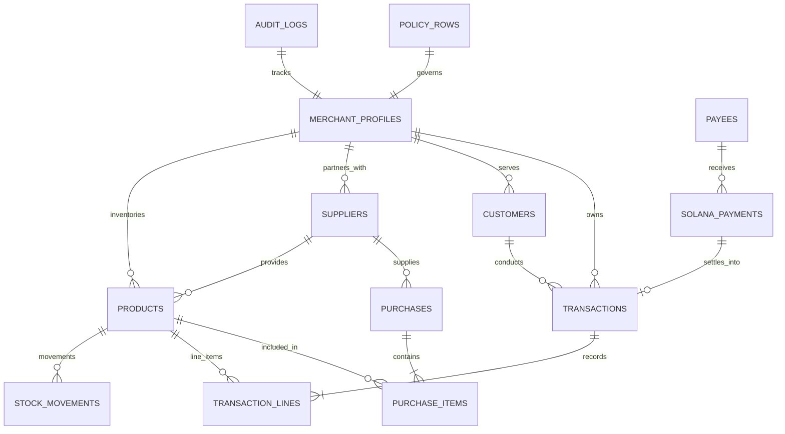

# SOLEPARTNER — COMPREHENSIVE DATA MODEL SPECIFICATION
**Version:** 1.0.0-PROD  
**Engine:** Drift (SQLite 3.x with PRAGMA foreign_keys = ON)  
**Classification:** Database Architecture & Schema Specification (Phase 0)

---

## 1. Relational Entity Overview

The SolePartner data model is structured around **double-entry bookkeeping principles, auditable inventory tracking, and zero-trust blockchain settlement**:

---

## 2. Table Specifications & Data Dictionary

### 2.1. `merchant_profiles`
Single-row table storing business profile and currency configuration.
| Column | Type | Constraints | Description |
|---|---|---|---|
| `id` | INTEGER | PRIMARY KEY AUTOINCREMENT | Unique merchant ID |
| `shop_name` | TEXT | NOT NULL, LENGTH(1, 120) | Store display name |
| `owner_name` | TEXT | LENGTH(0, 120) | Merchant proprietor name |
| `business_type` | TEXT | LENGTH(0, 80) | Retail category (Kirana, General Store, etc.) |
| `language_code` | TEXT | LENGTH(2, 8), DEFAULT 'en' | Preferred locale (`en`, `hi`, `mr`, `ta`) |
| `currency_code` | TEXT | LENGTH(3, 3), DEFAULT 'INR' | Base ISO currency |
| `created_at` | DATETIME | NOT NULL | Profile creation timestamp |
| `updated_at` | DATETIME | NOT NULL | Last profile update timestamp |

---

### 2.2. `customers`
Customer directory for udhaar tracking and contact information.
| Column | Type | Constraints | Description |
|---|---|---|---|
| `id` | INTEGER | PRIMARY KEY AUTOINCREMENT | Unique customer ID |
| `name` | TEXT | NOT NULL, LENGTH(1, 120) | Customer name |
| `phone` | TEXT | LENGTH(0, 32) | Contact phone number |
| `address` | TEXT | LENGTH(0, 240) | Residential / delivery address |
| `notes` | TEXT | LENGTH(0, 500) | Merchant relationship notes |
| `archived` | BOOLEAN | DEFAULT FALSE | Soft-deletion flag |
| `created_at` | DATETIME | NOT NULL | Record creation timestamp |
| `updated_at` | DATETIME | NOT NULL | Last modification timestamp |

---

### 2.3. `suppliers`
Vendor and distributor directory.
| Column | Type | Constraints | Description |
|---|---|---|---|
| `id` | INTEGER | PRIMARY KEY AUTOINCREMENT | Unique supplier ID |
| `name` | TEXT | NOT NULL, LENGTH(1, 120) | Distributor / company name |
| `phone` | TEXT | LENGTH(0, 32) | Contact phone number |
| `address` | TEXT | LENGTH(0, 240) | Warehouse / depot location |
| `notes` | TEXT | LENGTH(0, 500) | Payment terms, GSTIN notes |
| `archived` | BOOLEAN | DEFAULT FALSE | Soft-deletion flag |
| `created_at` | DATETIME | NOT NULL | Registration timestamp |
| `updated_at` | DATETIME | NOT NULL | Modification timestamp |

---

### 2.4. `products`
Inventory catalog with purchase, sale pricing, and stock monitoring.
| Column | Type | Constraints | Description |
|---|---|---|---|
| `id` | INTEGER | PRIMARY KEY AUTOINCREMENT | Unique product ID |
| `name` | TEXT | NOT NULL, LENGTH(1, 160) | Product trade name |
| `sku` | TEXT | LENGTH(0, 64) | Stock Keeping Unit code |
| `barcode` | TEXT | LENGTH(0, 64) | EAN-13 / UPC barcode string |
| `category` | TEXT | LENGTH(0, 80) | Category (Grocery, Snacks, Beverages, etc.) |
| `unit` | TEXT | LENGTH(0, 24), DEFAULT 'pcs' | Measurement unit (`kg`, `pcs`, `ltr`, `pack`) |
| `purchase_price_paise`| INTEGER | DEFAULT 0 | Cost price in integer paise |
| `selling_price_paise` | INTEGER | DEFAULT 0 | Retail price in integer paise |
| `stock_qty` | REAL | DEFAULT 0.0 | Current available stock quantity |
| `min_stock_qty` | REAL | DEFAULT 0.0 | Low stock threshold for alerts |
| `supplier_id` | INTEGER | NULLABLE, REFERENCES `suppliers(id)` | Default vendor reference |
| `image_path` | TEXT | NULLABLE | Local file path to cached product thumbnail |
| `archived` | BOOLEAN | DEFAULT FALSE | Soft-deletion flag |
| `created_at` | DATETIME | NOT NULL | Product creation timestamp |
| `updated_at` | DATETIME | NOT NULL | Last catalog edit timestamp |

---

### 2.5. `transactions` (Ledger Entries)
Append-only immutable financial ledger.
| Column | Type | Constraints | Description |
|---|---|---|---|
| `id` | INTEGER | PRIMARY KEY AUTOINCREMENT | Unique transaction sequence ID |
| `kind` | TEXT | NOT NULL | `sale`, `expense`, `income`, `creditGiven`, `creditRepayment`, `purchasePayment`, `solanaPayment` |
| `amount_paise` | INTEGER | NOT NULL, CHECK(`amount_paise` > 0) | Gross transaction value in integer paise |
| `cash_delta_paise` | INTEGER | NOT NULL | Net cash flow impact (+/- paise) |
| `credit_delta_paise` | INTEGER | NOT NULL | Net customer udhaar impact (+/- paise) |
| `customer_id` | INTEGER | NULLABLE, REFERENCES `customers(id)` | Linked customer if credit/repayment |
| `supplier_id` | INTEGER | NULLABLE, REFERENCES `suppliers(id)` | Linked supplier if vendor payment |
| `method` | TEXT | NOT NULL | `cash`, `upi`, `bank`, `credit`, `solana` |
| `note` | TEXT | LENGTH(0, 500) | Merchant memo / voice transcript |
| `source` | TEXT | NOT NULL | `manual`, `voice`, `ai`, `solana` |
| `external_ref` | TEXT | NULLABLE | UPI UTR / Bank Ref / Solana Tx Sig |
| `occurred_at` | DATETIME | NOT NULL | Business date of occurrence |
| `created_at` | DATETIME | NOT NULL | System recording timestamp |
| `is_reversed` | BOOLEAN | DEFAULT FALSE | True if compensated by a reversal entry |
| `reversal_of_id` | INTEGER | NULLABLE, REFERENCES `transactions(id)` | Points to original ID if this row is a reversal |

---

### 2.6. `solana_payments`
Tracks cryptocurrency proposals, approvals, signatures, and verified on-chain states.
| Column | Type | Constraints | Description |
|---|---|---|---|
| `id` | INTEGER | PRIMARY KEY AUTOINCREMENT | Internal proposal ID |
| `idempotency_key` | TEXT | UNIQUE, LENGTH(8, 64) | Client-generated idempotent hash |
| `payee_id` | INTEGER | NULLABLE, REFERENCES `payees(id)` | Saved payee reference |
| `recipient_name` | TEXT | LENGTH(0, 120) | Recipient display label |
| `recipient_address` | TEXT | NOT NULL, LENGTH(32, 64) | Base58 Solana public key |
| `amount_lamports` | INTEGER | NOT NULL, CHECK(`amount_lamports` > 0) | Value in integer lamports (1 SOL = 1e9) |
| `inr_memo_paise` | INTEGER | DEFAULT 0 | Reference INR value memo |
| `network` | TEXT | DEFAULT 'devnet' | Blockchain cluster (`devnet`, `testnet`, `mainnet`) |
| `status` | TEXT | NOT NULL | `draft`, `awaitingApproval`, `approved`, `signing`, `submitted`, `confirmed`, `failed`, `rejected`, `unknown` |
| `request_text` | TEXT | LENGTH(0, 500) | Original voice / chat prompt |
| `signature` | TEXT | NULLABLE | 88-char Base58 transaction signature |
| `explorer_url` | TEXT | NULLABLE | Link to Solana Explorer |
| `ledger_transaction_id`| INTEGER| NULLABLE, REFERENCES `transactions(id)`| Compensating ledger transaction row |
| `error_message` | TEXT | NULLABLE | Cluster or wallet failure reason |
| `policy_snapshot_json`| TEXT | NULLABLE | Snapshot of spending limits at approval time |
| `created_at` | DATETIME | NOT NULL | Proposal creation timestamp |
| `updated_at` | DATETIME | NOT NULL | Status update timestamp |
| `confirmed_at` | DATETIME | NULLABLE | Verified on-chain confirmation timestamp |

---

### 2.7. `policy_rows`
Deterministic spending policy rules enforced prior to wallet invocation.
| Column | Type | Constraints | Description |
|---|---|---|---|
| `id` | INTEGER | PRIMARY KEY AUTOINCREMENT | Policy record ID |
| `max_per_payment_lamports` | INTEGER | NOT NULL | Maximum lamports per single transaction |
| `daily_limit_lamports` | INTEGER | NOT NULL | 24-hour rolling cap on outgoing lamports |
| `saved_recipients_only` | BOOLEAN | NOT NULL | Require recipient to be in `payees` table |
| `devnet_only` | BOOLEAN | NOT NULL | Enforce testnet cluster only |
| `require_approval` | BOOLEAN | NOT NULL | Require merchant explicit touch confirmation |
| `updated_at` | DATETIME | NOT NULL | Policy modification timestamp |

---

## 3. Database Indexes

For responsive 60 FPS performance, the following indexes are maintained in SQLite:
1. `idx_transactions_occurred_at`: Optimizes dashboard daily/weekly time-window aggregations.
2. `idx_transactions_customer_id`: Accelerates customer credit balance calculations and statement generation.
3. `idx_products_category`: Supports instant category tab switching in inventory catalog.
4. `idx_products_barcode`: Enables instantaneous camera/scanner barcode lookups.
5. `idx_solana_signature`: Enforces signature uniqueness check preventing replay attacks.

